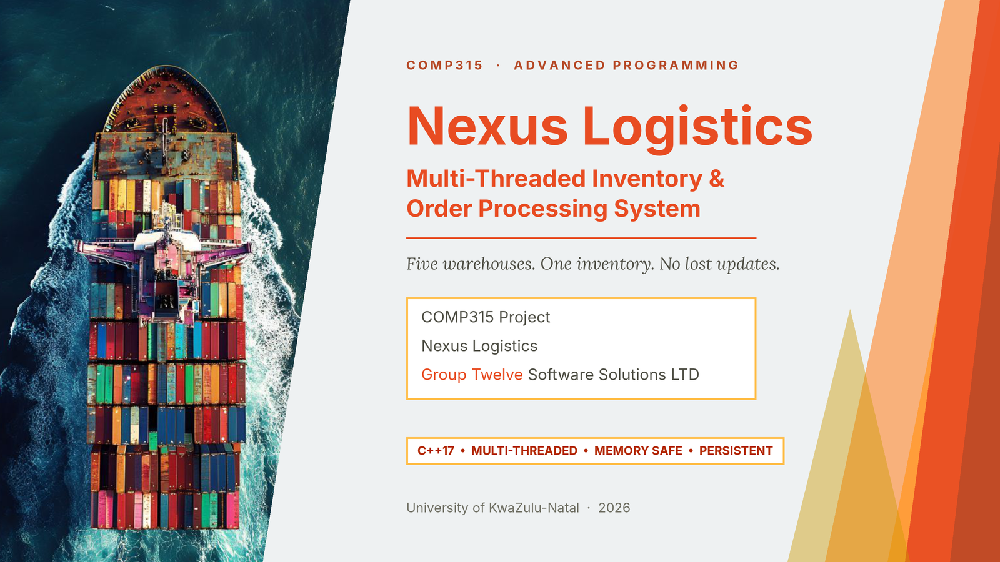
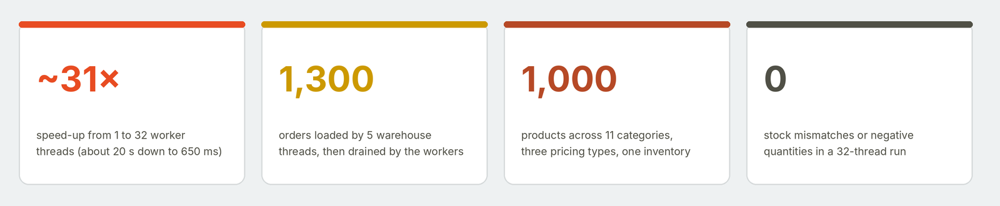
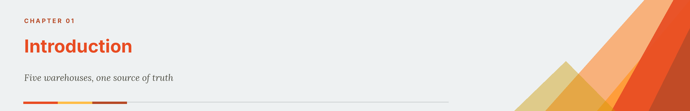
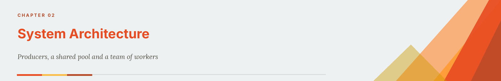
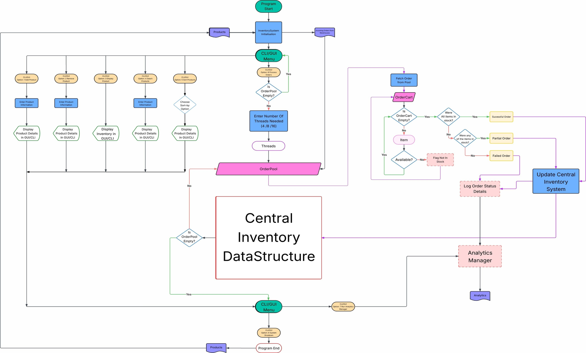
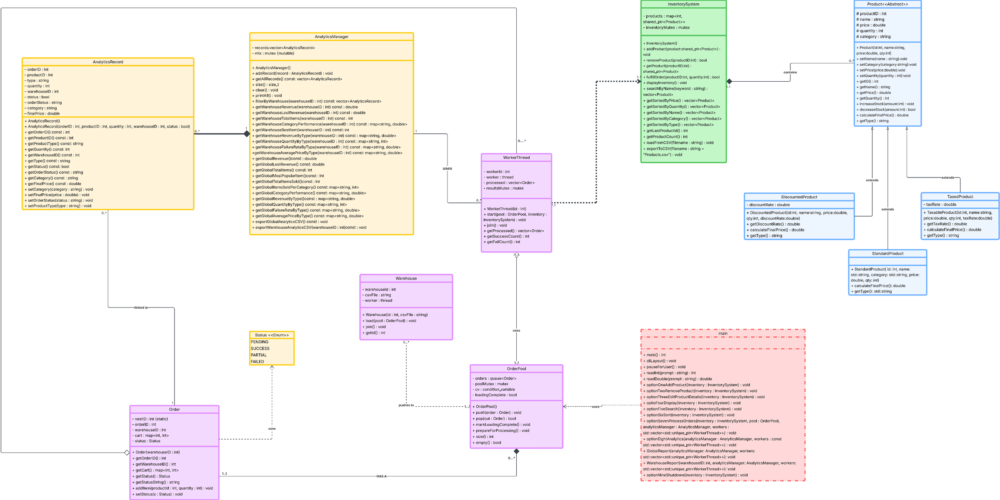
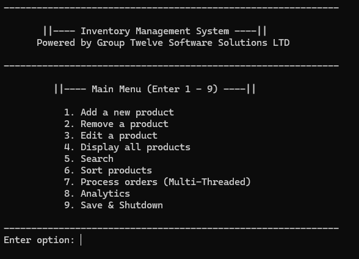
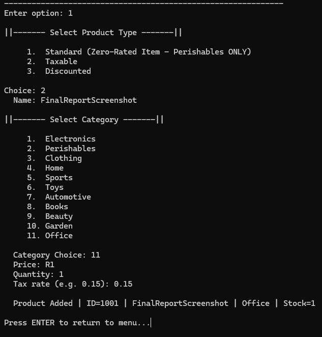
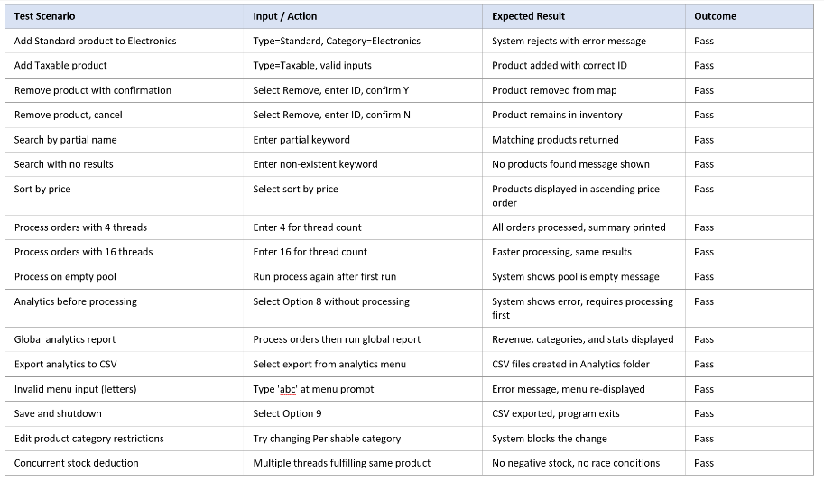
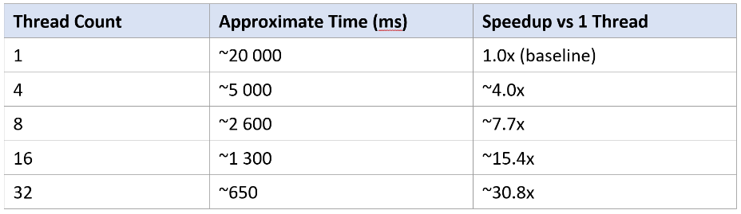

<a id="top"></a>
<p align="center"></p>

<p align="center">     </p>

<h3 align="center"><i>Five warehouses. One inventory. No lost updates.</i></h3>

<p align="center">
<a href="1.%20FinalReport/Group%20Twelve%20Software%20Solutions%20LTD%20Final%20Report.pdf"><b>Final report (PDF)</b></a> &nbsp;·&nbsp;
<a href="#running-the-project"><b>Run it</b></a> &nbsp;·&nbsp;
<a href="#5-using-the-system"><b>See the CLI</b></a> &nbsp;·&nbsp;
<a href="#4-concurrency-and-memory"><b>Read the concurrency design</b></a>
</p>

<p align="center"></p>

> [!IMPORTANT]
> **The command-line application (CLI) is the main and official submission.** All core functionality and grading criteria are implemented and demonstrated through the CLI.
>
> **The graphical interface (GUI) is a bonus and is incomplete.** It was built as extra effort beyond the brief, may have missing features or visual bugs, and should not be used as the basis for assessment.

<p align="center"></p>

## Abstract

Nexus Logistics runs several warehouses, each with its own way of managing stock, which makes inventory inconsistent and slows order handling. **Group Twelve Software Solutions LTD** was contracted to replace that with a single, central **multi-threaded inventory and order processing system** written in C++.

The system loads a catalogue of 1,000 products and the pending orders of five warehouses (1,300 orders), then processes those orders with a user-chosen number of worker threads, from 1 to 32. It is built as a producer–consumer pipeline: five warehouse threads parse order files into a shared **OrderPool**, and worker threads drain it, fulfilling every cart item against one central **InventorySystem** and logging the outcome as `SUCCESS`, `PARTIAL` or `FAILED`. Every shared structure is protected by a deliberately chosen primitive (a mutex, a mutex with a condition variable, or an atomic), and no thread ever holds two locks at once, which rules out deadlock by construction.

Processing time falls from about 20 seconds on one thread to about 650 milliseconds on 32, a speed-up of about 31×. In a rebuild-and-rerun check for this README, final stock matched the analytics records exactly, with no negative quantities. An analytics subsystem turns the per-item records into global and per-warehouse reports that export to CSV for Excel or Power BI, and the inventory saves itself when the program closes. A Qt 6 graphical interface was also started as a bonus.

**Keywords:** C++17, multi-threading, producer–consumer, mutex, condition variable, std::atomic, polymorphism, smart pointers, STL, inventory management, analytics.

[Back to top ↑](#top)

## Contents

**About the project**

- [Abstract](#abstract)
- [Project formalities](#project-formalities)
- [Repository map](#repository-map)
- [Running the project](#running-the-project)

**The system**

1. [Introduction](#1-introduction)
2. [System architecture](#2-system-architecture)
3. [Class design](#3-class-design)
4. [Concurrency and memory](#4-concurrency-and-memory)
5. [Using the system](#5-using-the-system)
6. [The GUI (bonus)](#6-the-gui-bonus)
7. [Testing and performance](#7-testing-and-performance)
8. [Challenges](#8-challenges)
9. [Conclusion](#9-conclusion)

**Back matter**

- [References](#references)
- [AI disclosure](#ai-disclosure)
- [Licence and attribution](#licence-and-attribution)

<p align="center"></p>

## Project formalities

|               |                                                                                  |
|---------------|----------------------------------------------------------------------------------|
| **Course**    | COMP315 Advanced Programming (2026), University of KwaZulu-Natal                 |
| **Project**   | Multi-Threaded Inventory and Order Processing System (C++)                       |
| **Client**    | Nexus Logistics (fictional client for the assignment)                            |
| **Group**     | Group Twelve Software Solutions LTD                                              |

| Member                | Student number | Role                                              | Contribution |
|-----------------------|----------------|---------------------------------------------------|:------------:|
| Yahya Bobat           | 223020664      | Lead developer                                    | 15%          |
| Jawad Kachbal         | 223037045      | High-level system design flow and developer       | 15%          |
| Yusuf Sheikh          | 224068106      | Documentation and presentation                    | 14%          |
| Mahomed Valli Mahomed | 224005878      | Overall class and system design, diagram design   | 14%          |
| Muhammad Varachia     | 224004509      | Overall class and system design, presentation     | 14%          |
| Kiyan Krishna         | 224115592      | Assisting across categories, system testing       | 14%          |
| Andiswa Hlengwa       | 221002430      | GUI design and implementation                     | 14%          |

### Deliverables

| Deliverable                              | Where                                                                                                                                                                      |
|------------------------------------------|----------------------------------------------------------------------------------------------------------------------------------------------------------------------------|
| Final report                             | [`Group Twelve Software Solutions LTD Final Report.pdf`](1.%20FinalReport/Group%20Twelve%20Software%20Solutions%20LTD%20Final%20Report.pdf)                                  |
| CLI source (main submission)             | [`2. Final Source Code/CLI Source Code (Main Submission)`](2.%20Final%20Source%20Code/CLI%20Source%20Code%20%28Main%20Submission%29/COMP315%20Project%20Final)             |
| GUI source (bonus)                       | [`2. Final Source Code/BONUS - GUI`](2.%20Final%20Source%20Code/BONUS%20-%20GUI/GUI%20Final%20Source%20Code/SourceCode)                                                    |
| Compiled CLI (Windows)                   | [`3. Final Compiled Project exes/1. CLI (Main Submission)`](3.%20Final%20Compiled%20Project%20exes/1.%20CLI%20%28Main%20Submission%29)                                      |
| Compiled GUI (Windows, zipped)           | [`3. Final Compiled Project exes/2. BONUS - GUI/GUI Final.zip`](3.%20Final%20Compiled%20Project%20exes/2.%20BONUS%20-%20GUI/GUI%20Final.zip)                                |

> [!NOTE]
> The report runs to 34 pages because it contains 31 diagrams and seven pages of formatting; without those it is 24 pages, within the page requirement.

## Repository map

```
.
├── README.md                                   this page
├── Final Report.pdf                            a copy of the final report
├── docs/readme/                                images used by this page (banners, diagrams, tables)
│
├── 1. FinalReport/
│   ├── Group Twelve Software Solutions LTD Final Report.pdf
│   └── FinalReport README.txt                  note on the report's page count
│
├── 2. Final Source Code/
│   ├── CLI Source Code (Main Submission)/
│   │   └── COMP315 Project Final/              Code::Blocks project (COMP315 Project.cbp)
│   │       ├── main.cpp                        menu, input validation, order-processing modes
│   │       ├── InventorySystem  .cpp/.h        central inventory, mutex-protected
│   │       ├── Product, StandardProduct,
│   │       │   TaxableProduct, DiscountedProduct   the polymorphic product hierarchy
│   │       ├── Order, OrderPool                carts and the shared producer-consumer queue
│   │       ├── Warehouse, WorkerThread         producer and consumer threads
│   │       ├── AnalyticsRecord, AnalyticsManager   per-item records, reports, CSV export
│   │       ├── Logger.h                        serialised console output
│   │       ├── Catalog/                        Products.csv, Updated_Products.csv
│   │       ├── Orders/                         Warehouse1..5_Orders.csv
│   │       └── Analytics/                      Global/ and Warehouses/Warehouse 1..5/
│   │
│   └── BONUS - GUI/GUI Final Source Code/SourceCode/     Qt 6 CMake project (incomplete)
│       ├── final_project_v2/                   the CLI back end, reused
│       ├── src/ui/                             Dashboard, Inventory, Analytics, Orders, Logs, Settings
│       ├── src/integration/                    service adapters and the app controller
│       ├── src/models/                         DTOs passed between layers
│       └── assets/, resources/                 icons, logo, card patterns, style.qss
│
├── 3. Final Compiled Project exes/
│   ├── 1. CLI (Main Submission)/               RUN ME COMP315 Project.exe, MinGW DLLs, CSV folders
│   └── 2. BONUS - GUI/GUI Final.zip            Qt build plus "Run NexusLogisticsGUI Final.bat"
│
└── GUI Final Source Code/                      a second copy of the GUI source (same code)
```

[Back to top ↑](#top)

<p align="center"></p>

## Running the project

The quickest route is the pre-built Windows CLI (option A). Building from source needs a C++17 compiler with thread support.

| You need                              | For                                    | Notes                                             |
|---------------------------------------|----------------------------------------|---------------------------------------------------|
| Windows 10 or 11                      | the pre-built CLI and GUI              | MinGW runtime DLLs are bundled next to the `.exe` |
| Code::Blocks with MinGW GCC           | building the CLI in the IDE            | C++17 or later                                    |
| Any C++17 compiler (g++, clang++)     | building the CLI from the command line | link with `-pthread` on Linux and macOS           |
| Qt 6 with Widgets, Concurrent, Charts | building the GUI                       | Qt Creator and CMake                              |

### A. Run the pre-built CLI (recommended)

1. Open [`3. Final Compiled Project exes/1. CLI (Main Submission)`](3.%20Final%20Compiled%20Project%20exes/1.%20CLI%20%28Main%20Submission%29).
2. Double-click **`RUN ME COMP315 Project.exe`**.
3. Follow the numbered menu in the terminal window.

> [!WARNING]
> Keep the `Catalog/`, `Orders/` and `Analytics/` folders in the same directory as the `.exe`. The program reads and writes its CSV files there. Analytics exports are written into the existing `Analytics/Global/` and `Analytics/Warehouses/Warehouse N/` folders, so do not delete those sub-folders.

### B. Build the CLI from source

**Code::Blocks:** open `COMP315 Project.cbp` in `2. Final Source Code/CLI Source Code (Main Submission)/COMP315 Project Final/`, pick **Debug** or **Release**, and build with `Ctrl+F9`. The executable lands in `bin/`; keep the three data folders beside it when running outside the IDE.

**Command line (any platform):** from the same folder,

```
g++ -std=c++17 -O2 -pthread -o nexus *.cpp
./nexus
```

The source has no Windows-only dependencies, and this build was checked on Linux with g++ (see [Section 7.4](#74-an-independent-rebuild)).

### C. Run the pre-built GUI (bonus)

1. Unzip `3. Final Compiled Project exes/2. BONUS - GUI/GUI Final.zip` (about 72 MB).
2. Double-click **`Run NexusLogisticsGUI Final.bat`** in the extracted `GUI Final` folder. It launches `Build\NexusLogistics.exe`.

Do not move the `.exe` out of `Build/`: it relies on the Qt DLLs beside it.

### D. Build the GUI from source (bonus)

1. Install Qt Creator with Qt 6 (including Qt Charts) and a MinGW or MSVC kit.
2. Open `CMakeLists.txt` in `.../GUI Final Source Code/SourceCode/`, select the kit, and choose **Build → Build All**.
3. Run from Qt Creator.

[Back to top ↑](#top)

<p align="center"></p>

## 1 Introduction

### 1.1 The problem

Nexus Logistics operates several warehouses, each with its own management system. Running them separately creates inconsistent stock data, slow order processing and an inconsistent hand-off of order information to downstream partners. The brief was a **centralised, high-performance, multi-threaded inventory and order processing system** that unites all warehouses behind one source of truth.

### 1.2 Objectives

- A centralised inventory shared by every warehouse.
- One consistent order format that all warehouses follow.
- Seamless adding and removing of stock, with stock and order transactions tracked through a single point.
- Easy export of order data to partners and logistics operations.
- Analytics across all threads, in a CSV format that opens directly in Microsoft Excel and Power BI.

### 1.3 What was delivered

| Feature                  | What the system does                                                                                                                                         |
|--------------------------|--------------------------------------------------------------------------------------------------------------------------------------------------------------|
| Product management       | Add, remove and edit products; full catalogue display; import from CSV                                                                                       |
| Search and sort          | Search by name (partial match) or product ID; sort by price, quantity, name, category or type                                                                |
| Concurrent orders        | 1 to 32 worker threads, chosen at run time, fed by five warehouse threads                                                                                    |
| Order modes              | **Backlog**: process the orders waiting in the warehouse CSV files. **Real-time**: five generators create random orders continuously until the user stops it |
| Analytics                | Global and per-warehouse reports: revenue, lost revenue, category performance, product-type breakdown, failure rates, most popular items; CSV export         |
| Persistence              | On exit, the inventory is written to `Catalog/Updated_Products.csv`, so the system "saves itself"                                                            |
| Interfaces               | A full CLI for resource-limited machines, and a Qt GUI (bonus)                                                                                               |

The catalogue holds **1,000 products in 11 categories**, and the five order files hold **1,300 orders** (260 each). Thread counts up to 32 were tested; the cap is a design choice and the limit is configurable in code.

[Back to top ↑](#top)

<p align="center"></p>

## 2 System Architecture

### 2.1 Data flow

<p align="center"><a href="docs/readme/report/system-flowchart.png"></a></p>

<p align="center"><sub><b>Figure 1.</b> System flowchart from the report (select to enlarge). Its menu numbering is from an earlier design; the final CLI has nine options (Section 5).</sub></p>

1. On start-up the **InventorySystem** loads `Products.csv` into memory.
2. **Five warehouse threads** read `Warehouse1..5_Orders.csv` and push `Order` objects into the shared **OrderPool**.
3. When the user chooses *Process orders*, a chosen number of **worker threads** start.
4. Each worker pops an order and works through its cart item by item, checking stock and decrementing it atomically.
5. The order is marked `SUCCESS` (every item fulfilled), `FAILED` (none) or `PARTIAL` (some), and an `AnalyticsRecord` is created for each item.
6. The **AnalyticsManager** stores the records; the CLI or GUI displays the results and can export them.

The two phases never overlap: warehouse threads finish loading before any worker starts, so producers and consumers are separated in time as well as in role.

### 2.2 File formats

Products and orders are plain CSV, which also makes a later database connection straightforward.

```
Products.csv        ProductID,Name,Category,Price,QTY,TYPE,TaxRate,DiscountRate
                    1,Gloves Touchscreen Compatible,Clothing,599,120,T,0.15,0

WarehouseN_Orders   ProductID,QTY,ProductID,QTY, ...      one order cart per line
```

`TYPE` is `S` (Standard), `T` (Taxable) or `D` (Discounted); `TaxRate` and `DiscountRate` are `0` where they do not apply. The shipped catalogue contains 482 discounted, 457 taxable and 61 standard products.

[Back to top ↑](#top)

<p align="center"></p>

## 3 Class Design

<p align="center"><a href="docs/readme/report/uml-class-diagram.png"></a></p>

<p align="center"><sub><b>Figure 2.</b> UML class diagram (select to enlarge).</sub></p>

### 3.1 The product hierarchy

`Product` is an abstract base class holding the shared state (ID, name, price, quantity, category) and two **pure virtual** functions, `calculateFinalPrice()` and `getType()`. Three concrete classes implement them:

| Class               | Final price                             | Rule                                                              |
|---------------------|-----------------------------------------|-------------------------------------------------------------------|
| `StandardProduct`   | `price`                                 | Zero-rated; allowed **only** in the *Perishables* category        |
| `TaxableProduct`    | `price × (1 + taxRate)`                 | Tax rate comes from the CSV (0.15 by default)                     |
| `DiscountedProduct` | `price × (1 − discountRate) × 1.15`     | Discount applied first, then the flat 15% tax                     |

`StandardProduct` exists because the base class is abstract and cannot be instantiated; it also models tax-free goods.

### 3.2 Object-oriented principles

| Principle         | Where it appears                                                                                                              |
|-------------------|-------------------------------------------------------------------------------------------------------------------------------|
| **Encapsulation** | Attributes are private or protected and reached through getters and setters, so invalid changes are blocked                   |
| **Abstraction**   | The abstract `Product` defines the interface and hides how each type prices itself                                            |
| **Inheritance**   | Three product types reuse the shared attributes of `Product`                                                                  |
| **Polymorphism**  | Products are held as `std::shared_ptr<Product>`, so one container handles every type and calls the right override at run time |
| **Composition**   | `AnalyticsManager` owns its `AnalyticsRecord` objects, which exist only inside it                                             |

Virtual functions are essential here: the correct price calculation cannot be known at compile time, and new product types can be added without touching the code that uses them.

### 3.3 Data structures and STL algorithms

| Structure                                    | Used for                         | Why                                                                                  |
|----------------------------------------------|----------------------------------|--------------------------------------------------------------------------------------|
| `std::map<int, std::shared_ptr<Product>>`    | The central inventory            | Unique IDs, O(log n) insert, lookup and delete, sorted by ID                         |
| `std::queue<Order>`                          | The OrderPool                    | FIFO fairness, O(1) enqueue and dequeue, ideal for producer–consumer                 |
| `std::map<int, int>`                         | An order's cart                  | ProductID → quantity, no duplicate lines in one order                                |
| `std::vector<std::shared_ptr<Product>>`      | Snapshots and sorting            | Contiguous memory and compatibility with `std::sort`                                 |
| `std::vector<std::unique_ptr<WorkerThread>>` | Worker management                | Exclusive ownership, any number of threads                                           |
| `std::vector<AnalyticsRecord>`               | Analytics storage                | Cheap sequential storage for report calculation                                      |
| `std::find_if`, `std::sort`                  | Search and sort                  | Lambda predicates and comparators: O(n) search, O(n log n) sort                      |

Name search is a linear scan with partial matching, because the map is keyed by ID; ID search is a direct map lookup.

[Back to top ↑](#top)

<p align="center"></p>

## 4 Concurrency and Memory

### 4.1 Thread model

The system runs in two separated phases. In **Phase 1 (loading)** five `Warehouse` threads read their CSV files and push orders into the pool. In **Phase 2 (processing)** the user-selected number of `WorkerThread`s (typically 4, 8 or 16; up to 32) pop orders until the pool is empty and loading is marked complete. The pool's `loadingComplete` flag is reset by `prepareForProcessing()` between phases so repeat runs start clean.

### 4.2 Every shared resource has an explicit guard

| Shared resource        | Location                       | Synchronisation                                | Risk without it           |
|------------------------|--------------------------------|------------------------------------------------|---------------------------|
| Order ID counter       | `Order::nextID`                | `std::atomic<int>` with `fetch_add`            | Duplicate order IDs       |
| Order queue            | `OrderPool::orders`            | `std::mutex` + `std::condition_variable`       | Torn queue, busy-waiting  |
| Inventory map          | `InventorySystem::products`    | `std::lock_guard<std::mutex>`                  | Negative stock            |
| Analytics records      | `AnalyticsManager::records`    | `std::lock_guard<std::mutex>`                  | Vector reallocation crash |
| Per-worker results     | `WorkerThread::processed`      | `std::lock_guard<std::mutex>`                  | Read-while-write race     |
| Console output         | `Logger.h` `printMutex`        | `std::mutex` via the `LOG` macro               | Interleaved output        |

### 4.3 The two critical sections

The stock decrement is the most important line in the program. Holding the inventory lock across the whole lookup-and-decrement makes it impossible for two workers to both see the last unit and both take it:

```cpp
bool InventorySystem::fulfillOrder(int productId, int quantity) {
    std::lock_guard<std::mutex> lock(inventoryMutex);
    auto it = products.find(productId);
    if (it != products.end())
        return it->second->decreaseStock(quantity);
    return false;
}
```

Workers wait for orders on a condition variable with a predicate, which sleeps instead of spinning, survives spurious wake-ups, and lets workers exit cleanly once loading is complete and the queue is empty:

```cpp
bool OrderPool::pop(Order& out) {
    std::unique_lock<std::mutex> lock(poolMutex);
    cv.wait(lock, [this] { return !orders.empty() || loadingComplete; });
    if (orders.empty())
        return false;           // pool is done and empty: the worker stops
    out = orders.front();
    orders.pop();
    return true;
}
```

### 4.4 Three races found and removed

| Race                  | What went wrong                                                         | Fix                                                        |
|-----------------------|-------------------------------------------------------------------------|------------------------------------------------------------|
| Stock decrement       | Two workers read stock = 1, both pass the check, both decrement         | Hold `inventoryMutex` across all of `fulfillOrder()`       |
| Order ID              | Two warehouse threads read the same `nextID`                            | `std::atomic<int>::fetch_add`, a single indivisible step   |
| Queue corruption      | Concurrent `push` and `pop` on `std::queue`                             | Route every queue operation through `poolMutex`            |

**Deadlock prevention** is a design rule rather than luck: *no thread ever holds two mutexes at once.* Every public method takes at most one lock, so the cyclic wait that deadlock needs cannot form. A coarse-grained inventory lock was chosen over per-product locks because it makes read-modify-write atomic by construction, and the critical section is short; slow operations such as displaying the inventory copy pointers under the lock and print after releasing it. Logging once per order, not per item, stops the print mutex becoming a bottleneck.

### 4.5 Memory management

All dynamic objects are owned by smart pointers, so there are no manual `delete`s:

- `std::shared_ptr<Product>` for **shared** domain objects (the inventory, workers and analytics all reference the same product).
- `std::unique_ptr<WorkerThread>` for **single-owner** resources.
- RAII lock guards (`std::lock_guard`, `std::unique_lock`) release mutexes even when an exception is thrown.

The pointer type is chosen by ownership requirement, not convenience, and smart pointers (lifetime) and mutexes (access) are kept as separate concerns.

[Back to top ↑](#top)

<p align="center"></p>

## 5 Using the System

### 5.1 The main menu

<p align="center"></p>

<p align="center"><sub><b>Figure 3.</b> The main menu, the only entry point. Every action returns here, and input is validated so that typing letters cannot break the prompt.</sub></p>

| Option | What it does                                                                                                      |
|:------:|-------------------------------------------------------------------------------------------------------------------|
| 1      | **Add** a product: choose type, name, category (11), price and quantity; business rules are enforced              |
| 2      | **Remove** a product by ID or by searching its name, with a confirmation showing its details                     |
| 3      | **Edit** a product's name, category, price or quantity                                                            |
| 4      | **Display** the full inventory                                                                                    |
| 5      | **Search** by name (partial match) or ID                                                                          |
| 6      | **Sort** by price, quantity, type, name or category                                                               |
| 7      | **Process orders** (multi-threaded), in backlog or real-time mode                                                 |
| 8      | **Analytics**: global and per-warehouse reports, and CSV export                                                   |
| 9      | **Save and shutdown**: write the inventory to `Catalog/Updated_Products.csv` and exit                             |

### 5.2 Adding a product

<p align="center"></p>

<p align="center"><sub><b>Figure 4.</b> Adding a product. A <i>Standard</i> (zero-rated) product is rejected for any category except Perishables, and the same rule blocks category edits that would break it.</sub></p>

### 5.3 Processing orders

Option 7 opens a sub-menu:

1. **Process backlog orders** takes the 1,300 orders waiting from the five warehouse files. Choose 1 to 32 threads (values outside the range are clamped). Each worker prints a line per order with its worker ID, order ID, warehouse and status, then a summary reports threads used, total processed, fully succeeded, partially filled, failed and the time taken in milliseconds.
2. **Start real-time order processing** has five generator threads create random orders (1 to 4 items, quantities 1 to 30, product IDs 100 to 999, with random 200 to 800 ms pauses) while the workers process them, emulating live warehouse traffic. Press Enter to stop; a summary follows.

Every status line shows which thread handled which order, which is how concurrency is made visible:

```
[Worker  4] Order #4     | Warehouse 2 | Items: 1 | SUCCESS
[Worker  1] Order #1     | Warehouse 2 | Items: 4 | SUCCESS
[Worker  7] Order #3     | Warehouse 1 | Items: 4 | SUCCESS
```

### 5.4 Analytics

Each processed item becomes an `AnalyticsRecord` (order, product, warehouse, quantity, category, product type, final price, outcome). Reports can be generated for all warehouses or for one, and exported as CSV:

```
OrderID,WarehouseID,ProductID,ProductType,Category,Quantity,FinalPrice,ItemStatus,OrderStatus
26,1,3,Taxable,Beauty,2,918.85,SUCCESS,SUCCESS
```

Analytics must be generated after orders have been processed; before that the menu reports that there is nothing to show.

### 5.5 Screenshots of the CLI

The screenshots below are in the order they were captured. Select any image to open it at full size.

<p align="center">
<a href="https://github.com/user-attachments/assets/9dc2410b-c001-44f8-a6e0-05dfc62774a2"></a>
</p>

<p align="center">
<a href="https://github.com/user-attachments/assets/476817b0-6152-4e8c-a9a4-799297492357"></a>
</p>

<p align="center">
<a href="https://github.com/user-attachments/assets/49b78081-bde2-4b33-9b78-e1a94ed21f51"></a>
</p>

<p align="center">
<a href="https://github.com/user-attachments/assets/e177dd37-fe40-452f-a481-45567f44d492"></a>
</p>

<p align="center">
<a href="https://github.com/user-attachments/assets/7286a009-2c81-4ddd-a7b4-abaacd2b92eb"></a>
<a href="https://github.com/user-attachments/assets/f2d01326-aa86-4e6a-809f-3505a45faee4"></a>
</p>

<p align="center">
<a href="https://github.com/user-attachments/assets/fc85bdd8-3a3f-46fb-8248-970fbcd5c5c1"></a>
<a href="https://github.com/user-attachments/assets/65899b5a-5a8c-4096-a3e7-344281ea8067"></a>
</p>

<p align="center">
<a href="https://github.com/user-attachments/assets/9617ba2e-a894-4095-b392-2cd4c22d3060"></a>
</p>


[Back to top ↑](#top)

<p align="center"></p>

## 6 The GUI (Bonus)

> [!WARNING]
> The GUI is a bonus component and is **incomplete**. It is provided as-is and is not the basis for assessment.

Andiswa Hlengwa designed and built a **Qt 6** interface (Widgets, Concurrent and Charts) around the same C++ back end. It adds about 9,000 lines in `src/`, organised in three layers so the UI never touches the inventory directly:

| Layer                | Contents                                                                                                    |
|----------------------|-------------------------------------------------------------------------------------------------------------|
| `src/ui/`            | Six pages (Dashboard, Inventory, Analytics, Orders, Logs, Settings), a main window and a navigation button  |
| `src/integration/`   | `AppController`, `InventoryServiceAdapter`, `OrdersServiceAdapter` and `AnalyticsAggregator`                |
| `src/models/`        | Plain data-transfer objects: product, inventory snapshot, orders summary and batch result, logs, analytics  |

Styling lives in `resources/style.qss`, with a custom logo, navigation and product icons, and teal, orange, blue and grey card patterns for the dashboard.

### Screenshots of the GUI

Select any image to open it at full size.

<p align="center">
<a href="https://github.com/user-attachments/assets/930bba7f-fdd5-4e2d-9db5-416a0a87b896"></a>
</p>

<p align="center">
<a href="https://github.com/user-attachments/assets/89d24f6a-e24d-4a19-9f08-818467f71e01"></a>
</p>

<p align="center">
<a href="https://github.com/user-attachments/assets/651f600e-a20b-45be-bb48-30952063f498"></a>
<a href="https://github.com/user-attachments/assets/cf3f4eea-62bc-4c43-8ac7-c7855c120037"></a>
</p>

<p align="center">
<a href="https://github.com/user-attachments/assets/2a35cc6d-2530-41f6-94da-e4db83519c2d"></a>
<a href="https://github.com/user-attachments/assets/f41b7d4c-c62a-4a10-935e-8a92b2c56b5c"></a>
</p>

<p align="center">
<a href="https://github.com/user-attachments/assets/4a0f61f7-3ab6-4fd5-9606-b91372c2021b"></a>
<a href="https://github.com/user-attachments/assets/7064b95a-c687-4460-bcc9-07d1e106d4ad"></a>
</p>

<p align="center">
<a href="https://github.com/user-attachments/assets/8e55d266-282f-4e35-9cf9-f308afaf16bf"></a>
<a href="https://github.com/user-attachments/assets/25b6c022-a28d-4d0c-8573-d78489775a3d"></a>
</p>


[Back to top ↑](#top)

<p align="center"></p>

## 7 Testing and Performance

### 7.1 Manual test plan

Testing was manual, through structured CLI interaction with normal and edge-case inputs, repeated through development and on the final build. Concurrency was tested at 4, 8, 16 and 32 threads.

<p align="center"></p>

<p align="center"><sub><b>Figure 5.</b> The 17 test scenarios from the report, all recorded as passing.</sub></p>

### 7.2 Inventory consistency

Correctness was checked by comparing three things: the initial stock from the CSV, the final stock after processing, and the quantities the analytics report as sold. They matched, with no negative stock and no duplicate deductions, even at 32 workers.

### 7.3 Scaling

Time to process the 1,300-order backlog, measured with `std::chrono::high_resolution_clock`:

<p align="center"></p>

<p align="center"><sub><b>Figure 6.</b> Report measurements on the team's Windows machine.</sub></p>

Each order includes a simulated 1 ms processing delay (standing in for a database write or network call); without it the work is so fast that thread scaling does not show. The speed-up is therefore largely overlapping that wait, and it flattens once the inventory mutex and the hardware become the limit.

### 7.4 An independent rebuild

For this README the CLI was rebuilt from source on Linux (g++, `-std=c++17 -O2 -pthread`) and run against the shipped data. It compiled without changes and loaded **1,000 products** and **1,300 orders**.

| Threads | Time (ms), Linux, 2 cores | Speed-up | Report (Windows) |
|--------:|--------------------------:|---------:|-----------------:|
| 1       | 1,444                     | 1.0×     | 1.0×             |
| 4       | 362                       | 4.0×     | ~4.0×            |
| 8       | 183                       | 7.9×     | ~7.7×            |
| 16      | 90                        | 16.0×    | ~15.4×           |
| 32      | 46                        | 31.4×    | ~30.8×           |

The scaling matches the report. The absolute times differ because of the platform: the report's single-thread figure of about 20 s is roughly 15 ms per order, which suggests Windows rounds the 1 ms sleep up to its coarser timer tick, while Linux honours it (1,300 × about 1.1 ms ≈ 1.4 s).

Stock integrity was checked too. After a 32-thread run, the exported `Updated_Products.csv` was compared with the starting catalogue and the exported analytics: for all 1,000 products, *starting stock − units sold = final stock*, exactly, with **no negative quantities** (4,597 units sold in that run).

### 7.5 Limitations and assumptions

- **Scheduling affects who gets contested stock.** When several orders want the last units of a product, which one succeeds depends on thread timing, so the success/partial/failed counts can differ slightly between runs and thread counts (fully succeeded orders ranged from 675 to 699 across the runs above). Stock totals never differ.
- **Name search is linear.** Fine for about 1,000 products, but a secondary index would be needed at larger sizes.
- **Storage is CSV only.** There is no database, which limits scale and data integrity in production.
- **Analytics are computed on demand** by iterating all records; pre-aggregation would help larger datasets.
- **Single machine, shared memory.** Nothing is distributed; the 32-thread cap matches typical consumer hardware.
- **Coarse-grained locking.** One inventory mutex is simple and safe but is the bottleneck at high thread counts; per-product locks or a partitioned inventory are the natural next step.
- **Export folders must exist.** Analytics export writes into existing `Analytics/` sub-folders and does not create them.

[Back to top ↑](#top)

<p align="center"></p>

## 8 Challenges

### 8.1 A Heisenbug in order IDs

Duplicate order IDs appeared only when all five warehouse threads ran together. Two threads were reading and incrementing the same static counter at once. The bug was hard to reproduce because adding logging changed the timing and made it vanish. **Thread-aware logging** (the worker ID plus `std::this_thread::get_id()` on every line) exposed the interleaving, and the fix was `std::atomic<int>` with `fetch_add(1)`.

### 8.2 STL is not thread-safe

Early code assumed it was. Three fixes followed:

| Component          | Problem                                                  | Fix                                              |
|--------------------|----------------------------------------------------------|--------------------------------------------------|
| `OrderPool`        | A raw queue with polling wasted CPU and left race windows | Producer–consumer with a `condition_variable`   |
| `InventorySystem`  | Unprotected `std::map` access: undefined behaviour       | `inventoryMutex` on every public method          |
| `AnalyticsManager` | Vector reallocation could invalidate references          | `lock_guard` around every `push_back`            |

### 8.3 A redesign mid-project

The first design had each warehouse thread load orders, process them, update the inventory and write its own log, which caused heavy contention and unclear ownership. The final design separates roles:

- **Warehouse threads (producers)** only parse CSV files and push orders.
- **Worker threads (consumers)** process orders and update the inventory through controlled access.
- **The central inventory** is the single authority for stock.
- **The AnalyticsManager** replaces per-warehouse logs with one report system.

Two late changes, the `StandardProduct` class (to enforce the Perishables-only rule) and the product category attribute, cut across the CLI, sorting, analytics and CSV export. Their cost was the main lesson: identify cross-cutting concerns early and put them in the class model before the implementation sets.

[Back to top ↑](#top)

<p align="center"></p>

## 9 Conclusion

The Nexus Logistics system meets its core objectives: a central inventory of 1,000 products, five warehouses loading 1,300 orders concurrently, 1 to 32 configurable worker threads, detailed analytics with CSV export, and an inventory that persists between runs. Its concurrency design is deadlock-free by rule and preserves stock exactly under every thread count tried, while processing time falls roughly in line with thread count, from about 20 s to about 650 ms in the report's measurements.

Three lessons stand out. Concurrency does not compose transparently: two correct pieces of code can misbehave when interleaved. Thread-aware logging was a better debugging tool than a debugger for non-deterministic faults. And RAII tools such as `lock_guard` and `unique_ptr` are engineering controls, not style, because they make a whole class of defects impossible to write.

[Back to top ↑](#top)

<p align="center"></p>

## References

cppreference.com (2024) *std::atomic*, *std::chrono::high_resolution_clock*, *std::condition_variable*, *std::mutex*, *std::shared_ptr*, *std::thread*, *std::unique_ptr*, *std::lock_guard*. Available at: https://en.cppreference.com

ISO/IEC (2020) *ISO/IEC 14882:2020 Programming Languages: C++*. Geneva: International Organization for Standardization.

Meyers, S. (2014) *Effective Modern C++*, Items 35–42 on concurrency. Sebastopol: O'Reilly Media.

Stroustrup, B. (2013) *The C++ Programming Language*. 4th edn. Boston: Addison-Wesley.

Williams, A. (2019) *C++ Concurrency in Action: Practical Multithreading*. 2nd edn. Shelter Island: Manning Publications.

## AI disclosure

The final report states that ChatGPT was used as a supplementary aid: refining the wording of report sections, improving formatting and structure, clarifying concepts in multi-threading and C++ practice, and reviewing and suggesting improvements to existing team-written code, without generating full implementations. The repository's earlier README also notes that AI-assisted tools such as GitHub Copilot may have been used for code suggestions, boilerplate and debugging. The group states that all code was written, tested and validated by its members, that AI was not used for formal testing or evaluation, and that design decisions and architecture are the group's own.

This README was drafted with the help of Claude (Anthropic) from the report and the source code. Its performance and stock-integrity figures in Section 7.4 come from rebuilding the CLI from source and running it, and its other figures were checked against the report and the code.

## Licence and attribution

No licence file has been added to this repository. The project is university coursework by Group Twelve Software Solutions LTD, and "Nexus Logistics" is the fictional client of the assignment.

<p align="center"><sub>GROUP TWELVE SOFTWARE SOLUTIONS · COMP315 · NEXUS LOGISTICS · UNIVERSITY OF KWAZULU-NATAL · 2026</sub></p>

<p align="right"><sub><a href="#top">Back to top ↑</a></sub></p>
